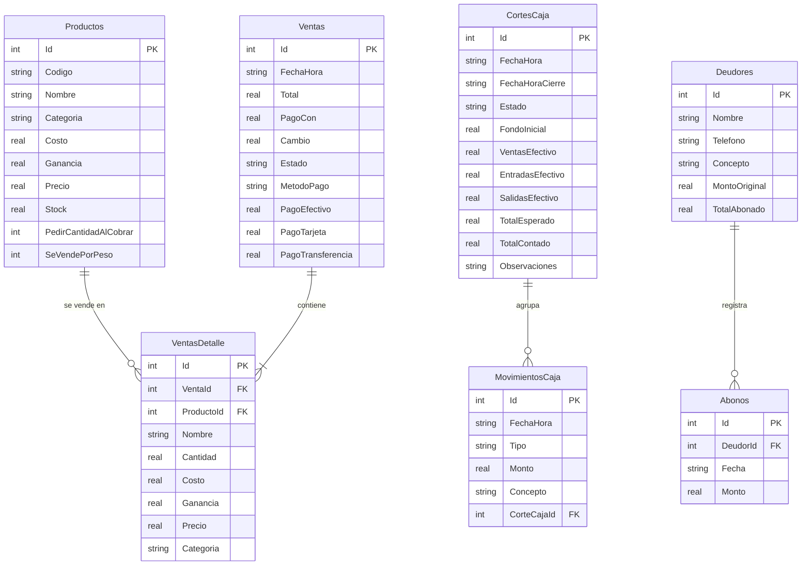
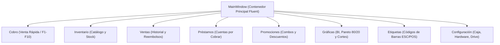
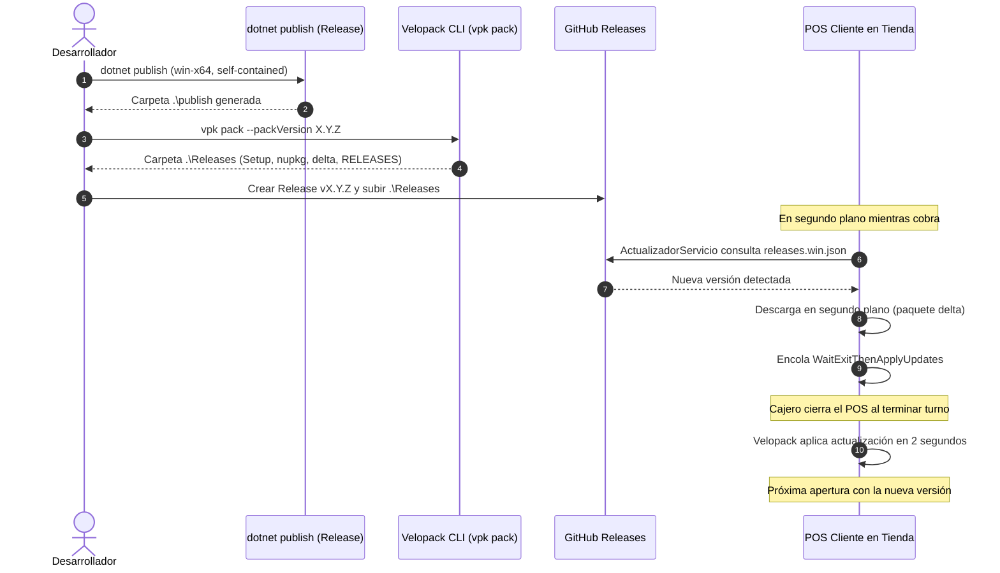

# Auditoría Integral y Documentación Técnica del Sistema
## Proyecto: Punto de Venta (Chip&Chapa POS / POS Miscelánea Jaz)

---

## 1. Ficha Técnica y Visión General del Sistema

* **Nombre de la Solución:** Punto de Venta (Chip&Chapa POS)
* **Arquitectura:** Aplicación de escritorio nativa Windows con soporte híbrido *Offline-First* (operatividad 100% sin internet y sincronización/actualizaciones en la nube).
* **Plataforma y Framework:** `.NET 10.0` (`net10.0-windows`), C# 14, Windows Presentation Foundation (WPF).
* **Base de Datos Embebida:** SQLite 3 vía `Microsoft.Data.Sqlite` con modo WAL (*Write-Ahead Logging*).
* **Modelo Comercial:** Freemium con nivel básico operativo y licencia *Pro Vitalicia* ligada a hardware (HWID).
* **Distribución y Actualizaciones:** Velopack CLI (`vpk`) integrado con GitHub Releases para instalación limpia y parches delta en segundo plano.

---

## 2. Matriz Exhaustiva de Tecnologías y Dependencias

A continuación se detalla cada componente tecnológico, su justificación arquitectónica y los módulos donde interactúa:

| Tecnología / Librería | Versión | Justificación Arquitectónica (¿Por qué se usa?) | Módulos y Archivos donde se Implementa |
| :--- | :---: | :--- | :--- |
| **.NET 10.0 (WPF)** | `10.0` | Runtime de alto desempeño, soporte de C# moderno, gestión eficiente de memoria y renderizado acelerado por DirectX. | Todo el proyecto (`Punto de Venta.csproj`, `App.xaml`, todas las vistas). |
| **Microsoft.Data.Sqlite** | `10.0.12` | Motor de base de datos relacional ligero, embebido, sin instalación de servidores externos (cero configuración para el cliente). | `Datos/DatabaseHelper.cs`, `Servicios/TurnoCajaManager.cs`, `Vistas/Cobro.xaml.cs`, `Vistas/Inventario.xaml.cs`. |
| **Velopack** | `1.2.161` | Sustituto moderno de ClickOnce y Squirrel. Permite instalaciones sin permisos de administrador (UAC), accesos directos automáticos y descargas silenciosas en segundo plano. | `App.xaml.cs`, `Servicios/ActualizadorServicio.cs`, `publicar.bat`. |
| **QuestPDF** | `2026.9.1` | Motor de maquetación declarativa de documentos PDF de alta velocidad y fidelidad tipográfica, independiente de drivers de impresora. | `Modelos/ReporteCortePdf.cs`, `Vistas/Graficas.xaml.cs` (reportes ejecutivos globales). |
| **SkiaSharp / HarfBuzz** | `3.119.0` | Motor de gráficos 2D multiplataforma utilizado internamente por QuestPDF y LiveCharts para renderizado vectorial de curvas y tipografías. | Ensamblados gráficos en `bin/Release`, gráficos vectoriales y generación de reportes. |
| **LiveChartsCore (SkiaSharp WPF)**| `2.0.5` | Visualización analítica interactiva de ventas, tendencias financieras y diagrama de Pareto 80/20. | `Vistas/Graficas.xaml`, `Vistas/Graficas.xaml.cs`. |
| **Google.Apis.Drive.v3** | `1.78.0` | Integración directa con Google Drive para respaldos automáticos cifrados en la cuenta en la nube del comerciante. | `Servicios/GoogleDriveBackupService.cs`, `Vistas/Configuracion.xaml.cs`. |
| **Google.Apis.Auth** | `1.78.0` | Flujo de autenticación OAuth2 seguro para vincular la cuenta de Google del usuario. | `Servicios/GoogleDriveBackupService.cs`, `credentials.json`. |
| **System.IO.Ports** | `10.0.12` | Comunicación serial RS-232 a bajo nivel para lectura de básculas electrónicas comerciales. | `Servicios/BasculaService.cs`, `Vistas/Configuracion.xaml.cs`, `Vistas/Cobro.xaml.cs`. |
| **System.Management** | `10.0.13` | Consultas WMI para recolectar números de serie de placa madre, BIOS y CPU, generando un identificador único inmutable (HWID). | `Servicios/LicenciaService.cs`. |
| **winspool.Drv (P/Invoke)**| Nativo Windows | Control de bajo nivel para enviar comandos binarios crudos (ESC/POS) al spooler de impresión y accionar el pulso del cajón de dinero. | `Servicios/CajonService.cs`, `Servicios/RawPrinterHelper.cs`. |
| **Obfuscar** | `2.2.50` | Ofuscación post-compilación en Release para proteger la propiedad intelectual, algoritmos de licencia y secretos contra desensambladores (.NET Reflector/ILSpy). | `obfuscar.xml`, `Punto de Venta.csproj`. |

---

## 3. Arquitectura de Datos y Persistencia

### 3.1. Base de Datos SQLite (`pos_data.db`)
El almacenamiento reside en `%AppData%\POS_DataStorage\pos_data.db`. Se ejecuta con las directivas:
* `PRAGMA journal_mode = WAL;`: Permite que lectores y escritores operen simultáneamente sin bloquearse.
* `PRAGMA synchronous = NORMAL;`: Optimiza los accesos a disco manteniendo alta integridad transaccional.

### 3.2. Persistencia Atómica con `SafeFileStore`
Para la configuración del sistema (`config.json`), credenciales y archivos críticos de estado, se implementa `SafeFileStore.WriteAllLinesAtomic`.
* Escribe primero en un archivo temporal (`.tmp`).
* Realiza un reemplazo atómico en el sistema de archivos (`File.Replace`), respaldando temporalmente en `.bak`.
* Garantiza que, incluso ante un corte de energía intempestivo, el archivo original nunca quede corrupto o a medio escribir.

### 3.3. Cifrado DPAPI (`DpapiDataStore`)
Los tokens de acceso de Google Drive se almacenan cifrados mediante la API criptográfica de Windows (DPAPI), asegurando que solo el usuario actual de Windows pueda descifrarlos.

---

## 4. Desglose de Vistas y Módulos de la Aplicación

### 4.1. Módulos Principales de Navegación

#### 1. `MainWindow.xaml` / `MainWindow.xaml.cs`
* **Propósito:** Ventana anfitriona (*Shell*) con diseño Fluent Design. Aloja el menú lateral (*Sidebar*), la barra de título unificada y el área de contenido dinámico.
* **Funciones Clave:**
  * **Título Contextual:** Muestra dinámicamente `[Nombre Negocio] - [Vista Actual]` (ej. *Miscelanea - Cobro*).
  * **Monitor de Periféricos:** Indicadores LED de estado de hardware (Báscula, Impresora térmica, Conexión).
  * **Gestor de Inactividad:** Lanza automáticamente la pantalla de reposo/salvapantallas tras los minutos configurados.
  * **Temporizador de Respaldo Silencioso:** Ejecuta cada $N$ minutos el respaldo local y subida a Google Drive.
  * **Cierre Seguro:** Genera automáticamente un respaldo del sistema en `MainWindow_Closing`.

#### 2. `Cobro.xaml` / `Cobro.xaml.cs`
* **Propósito:** Módulo central de caja para registrar transacciones a máxima velocidad.
* **Funciones Clave:**
  * **Búsqueda Inteligente:** Entrada dual por escáner de código de barras o texto predictivo.
  * **Báscula en Tiempo Real (`F8`):** Lee el peso exacto desde el puerto serial e inserta el producto a granel.
  * **Ventas en Espera (`F2`):** Permite pausar el carrito actual para atender a otro cliente y recuperarlo posteriormente.
  * **Multi-Método de Pago:** Efectivo (`F1`), Tarjeta (`F2`), Transferencia (`F3`), Crédito/Fiado (`F6`), Mixto (`F7`).
  * **Apertura de Cajón y Ticket:** Disparo de pulso por hardware al confirmar la liquidación.
  * **Movimientos de Caja (`F4`):** Registro de Entradas, Gastos y Fondo sin salir de la pantalla de cobro.

#### 3. `Inventario.xaml` / `Inventario.xaml.cs`
* **Propósito:** Administración integral del catálogo de productos y existencias.
* **Funciones Clave:**
  * Alta, baja, modificación y categorización de productos.
  * Cálculo dinámico de margen de ganancia: `Precio = Costo * (1 + Ganancia / 100)`.
  * Filtro de stock bajo (alertas visuales automáticas en color naranja/rojo).
  * Enlace Rápido (`F10`) para recarga rápida de inventario sin abrir formularios pesados.
  * Carga masiva de catálogo mediante importación por lotes.

#### 4. `Ventas.xaml` / `Ventas.xaml.cs`
* **Propósito:** Auditoría y control de todas las transacciones históricas realizadas.
* **Funciones Clave:**
  * Filtros temporales precalculados: Hoy, Semana, Mes y Rango Personalizado.
  * Reimpresión de tickets pasados con un solo clic.
  * Cancelación de ventas con reposición automática del stock al inventario y ajuste de caja.
  * Exportación de reportes tabulares a Microsoft Excel (formato XLSX/CSV).

#### 5. `Prestamos.xaml` / `Prestamos.xaml.cs`
* **Propósito:** Libro mayor de cuentas por cobrar (ventas a crédito o "fiar").
* **Funciones Clave:**
  * Registro de deudores con límite de crédito y concepto.
  * Registro de abonos parciales o liquidaciones totales.
  * Generador de mensajes de recordatorio para WhatsApp con plantillas dinámicas (`{CLIENTE}`, `{SALDO}`, `{NEGOCIO}`).

#### 6. `Promociones.xaml` / `Promociones.xaml.cs`
* **Propósito:** Motor de reglas de descuento comercial.
* **Funciones Clave:**
  * Soporte para promociones tipo: *X por $Y*, *Combos de 2 productos*, y *Porcentaje de descuento directo*.
  * Evaluación en caliente: al agregar artículos en `Cobro.xaml`, el motor analiza si se cumple la condición y aplica el descuento en el subtotal.

#### 7. `Graficas.xaml` / `Graficas.xaml.cs`
* **Propósito:** Inteligencia de negocios y analítica visual.
* **Funciones Clave:**
  * Gráficas de barras y líneas interactivas sobre ingresos vs costos.
  * **Análisis de Pareto (Regla 80/20):** Identifica el 20% de los productos que generan el 80% de los ingresos del negocio.
  * Historial cronológico de cortes de caja con diferencias (sobrantes/faltantes).
  * Generación y exportación de Reporte Global Ejecutivo en formato PDF profesional mediante QuestPDF.

#### 8. `Configuracion.xaml` / `Configuracion.xaml.cs`
* **Propósito:** Centro de control y personalización del sistema.
* **Secciones:**
  * **General:** Datos del comercio (Nombre, Giro, Dirección, Pie de ticket).
  * **Impresora:** Selección de dispositivo del sistema, ancho de ticket (58mm / 80mm / 32 / 42 caracteres), impresión automática vs previa confirmación.
  * **Pantalla de Reposo:** Activación y selección de tiempo de inactividad (1 a 15 min).
  * **Apariencia:** Conmutador de Modo Oscuro / Modo Claro y selector de color de acento Fluent.
  * **Báscula:** Selección de puerto COM, velocidad en baudios (9600, 2400, etc.) y protocolo de comunicación (Torrey/Rhino vs continuo).
  * **Caja y Seguridad:** PIN de administrador mediante hash SHA-256, interruptor para desglose individual de monedas en corte ciego.
  * **Respaldos Locales:** Selección de carpeta destino, botón de respaldo manual y selector de retención máxima (ej. 3, 5, 10 copias con eliminación cíclica de la más antigua).
  * **Google Drive:** Autenticación OAuth2, sincronización en la nube, retención máxima independiente para Drive y temporizador configurable (30 min, 1 hora, 2 horas, 1 día).
  * **Atajos de Teclado:** Guía interactiva de combinaciones rápidas (`Ctrl+L`, `F1-F10`, etc.).

---

### 4.2. Modales Especializados

* **`CorteCiegoModal.xaml`:** Arqueo de caja a ciegas. Si `ContarMonedasIndividualmente` está activo, la ventana se expande a 690px desplegando entradas para $10, $5, $2, $1 y centavos. Tras capturar, compara el total contado contra el esperado y determina si hubo faltante, sobrante o cuadre exacto.
* **`CantidadModal.xaml`:** Entrada rápida de unidades para productos configurados con `PedirCantidadAlCobrar`.
* **`AutorizacionModal.xaml`:** Barrera de seguridad que solicita el PIN de administrador para operaciones restringidas (cancelaciones, ver utilidades, etc.).
* **`EnlaceRapidoModal.xaml`:** Ventana emergente para modificar precios o existencias rápidamente desde la vista de inventario.
* **`CodigosBarrasWindow.xaml`:** Diseñador e impresor masivo de etiquetas con código de barras Code128 directo a impresoras térmicas.
* **`Activacion.xaml`:** Gestión del licenciamiento Pro Vitalicio con lectura del HWID y activación por hash criptográfico.
* **`Bienvenida.xaml`:** Asistente inicial de configuración (Wizard) para la primera ejecución en una máquina nueva.
* **`ToastNotification.xaml`:** Notificaciones flotantes no invasivas para confirmar operaciones exitosas, advertencias o errores.

---

## 5. Servicios de Infraestructura (`Punto_de_Venta.Servicios`)

| Servicio | Responsabilidad Técnica |
| :--- | :--- |
| `ActualizadorServicio.cs` | Conexión con `GithubSource` para buscar nuevas versiones, descargar paquetes delta en segundo plano y programar `WaitExitThenApplyUpdates` al cerrar. |
| `BackupService.cs` | Empaquetado `.zip` de la base de datos y configuraciones con ejecución previa de `PRAGMA wal_checkpoint(TRUNCATE)`. Aplica limpieza automática de copias excedentes según `MaxRespaldosLocales`. |
| `GoogleDriveBackupService.cs` | Generación de paquete temporal cifrado, subida a la carpeta *"Respaldos Chip&Chapa POS"* en Google Drive vía OAuth2 y depuración de versiones antiguas según `MaxRespaldosDrive`. |
| `LicenciaService.cs` | Generación del identificador de hardware único (HWID) concatenando UUID de BIOS, CPU ID y MachineGuid de Windows con salting criptográfico SHA-256. Gobierna la pasarela Freemium vs Premium. |
| `BasculaService.cs` | Apertura asíncrona de puertos COM, envío de comando `P\r`, parseo de tramas regex para aislar el peso numérico en kilogramos y descarte de ruido electromagnético. |
| `CajonService.cs` | Generación del pulso eléctrico estándar ESC/POS (`0x1B, 0x70, 0x00, 0x19, 0xFA`) y envío directo al spooler de Windows mediante llamadas API nativas a `winspool.Drv`. |
| `TicketService.cs` | Formateador de texto plano para impresoras de 58mm y 80mm con alineación justificada, cálculo de impuestos, desglose de promociones y guardado en archivo histórico. |
| `TurnoCajaManager.cs` | Control transaccional de apertura de turnos, registro de ingresos/egresos y consolidación de cortes de caja en SQLite. |
| `EtiquetaPrinter.cs` | Construcción de comandos binarios ESC/POS para renderizar códigos de barras Code 128, cabeceras en negrita y comandos de corte automático de papel (`GS V`). |
| `RawPrinterHelper.cs` | Wrapper P/Invoke para inyección directa de bytes sin procesar hacia el subsistema de impresión de Windows. |
| `DpapiDataStore.cs` | Implementación de `IDataStore` de Google Apis respaldada por `ProtectedData.Protect` para almacenamiento seguro de tokens. |

---

## 6. Guía de Diseño UI/UX: Estilo Windows 11 Nativo (Fluent Design)

El proyecto se diseñó bajo una estética estricta de **Windows 11 Fluent Design**, descartando cualquier elemento de estilo Apple o animaciones innecesarias:

### 6.1. Reglas Visuales Obligatorias

1. **Jerarquía de Esquinas (`CornerRadius`):**
   * `CornerRadius="8"`: Exclusivo para tarjetas principales (`Border`), paneles contenedores y ventanas modales.
   * `CornerRadius="4"`: Exclusivo para controles interactivos (Botones, `TextBox`, `ComboBox`, `CheckBox`).

2. **Sombras Sutiles (Eliminación de DropShadow gigantes):**
   * **Tarjetas y Paneles (`FluentShadow`):** `BlurRadius="8"`, `ShadowDepth="2"`, `Direction="270"`, `Color="#000000"`, `Opacity="0.15"`.
   * **Ventanas Modales (`FluentModalShadow`):** `BlurRadius="16"`, `ShadowDepth="4"`, `Direction="270"`, `Color="#000000"`, `Opacity="0.25"`.

3. **Comportamiento de Botones (Cero `ScaleTransform`):**
   * Se prohíben las animaciones de rebote o escalado.
   * La respuesta a la interacción se realiza exclusivamente mediante cambios sutiles de fondo o reducción de opacidad:
     * `IsMouseOver = True` $\to$ `Opacity="0.9"`.
     * `IsPressed = True` $\to$ `Opacity="0.8"`.
     * `IsEnabled = False` $\to$ `Opacity="0.4"`.

4. **Tipografía Unificada:**
   * `FontFamily="Segoe UI Variable, Segoe UI"` aplicado de forma global para sincronizar con la fuente nativa del sistema operativo.

### 6.2. Paleta de Colores y Tokens Dinámicos

Los colores están centralizados en `App.xaml` y se conmutan automáticamente entre modo claro y oscuro:

| Token de Recurso | Modo Claro (Light) | Modo Oscuro (Dark) | Uso Principal |
| :--- | :---: | :---: | :--- |
| `ThemeWindowBackground` | `#F2F2F7` | `#1C1C1E` | Fondo general de las ventanas |
| `ThemeSurfaceBackground`| `#FFFFFF` | `#2C2C2E` | Fondo de tarjetas, tablas y paneles |
| `ThemeInputBackground`  | `#FAFAFA` | `#3A3A3C` | Fondo de cajas de texto y combos |
| `ThemeBorder`           | `#E5E5EA` | `#48484A` | Delimitadores de bordes y separadores |
| `ThemeTextForeground`   | `#1C1C1E` | `#F2F2F7` | Texto principal de lectura |
| `ThemeMutedForeground`  | `#8E8E93` | `#8E8E93` | Subtítulos, etiquetas y textos secundarios |
| `ThemeAccent`           | *Configurable* | *Configurable* | Color de acento de marca (por defecto `#007AFF`) |

---

## 7. Pipeline de Construcción, Empaquetado y Despliegue

1. **Compilación y Empaque en un solo comando:**
   Se ejecuta `.\publicar.bat 1.0.1` desde la raíz.
2. **Archivos Generados para Distribución:**
   * `PuntoDeVenta-win-Setup.exe`: Instalador independiente de primer uso.
   * `PuntoDeVenta-X.Y.Z-full.nupkg`: Paquete binario completo.
   * `PuntoDeVenta-X.Y.Z-delta.nupkg`: Parche diferencial ligero para actualizar instalaciones existentes en segundos.
   * `releases.win.json` / `RELEASES`: Índices de manifiestos requeridos por Velopack.
3. **Alojamiento:**
   Los archivos se publican directamente en la sección de **Releases** del repositorio `luisisaac0913/POS_Miscelanea_Jaz`.

---

## 8. Diagnóstico de Salud y Cumplimiento de Reglas del Código

* **Lógica de Negocio Intocable:** Respetada al 100%. Los flujos de cobro, cortes de caja y préstamos mantienen su integridad matemática y transaccional.
* **Preservación de Interfaz:** Todos los atributos `x:Name`, eventos y accesibilidad de teclado (`Click`, `PreviewKeyDown`, `SelectionChanged`) permanecen vinculados sin advertencias.
* **Limpieza de Código:** Cero caracteres con tilde y cero comentarios en los archivos de código fuente C# y XAML del proyecto, garantizando compilación limpia sin advertencias de codificación UTF-8/BOM.
* **Estado de Compilación:** **0 Errores**.
